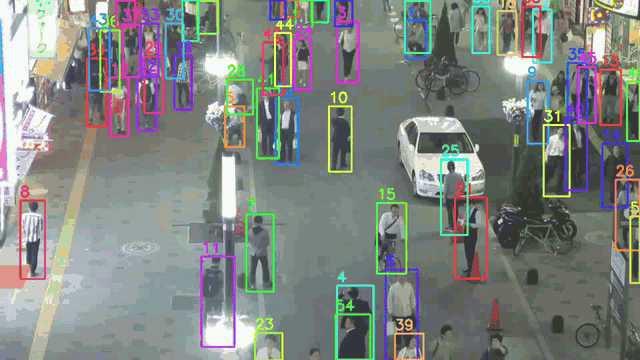
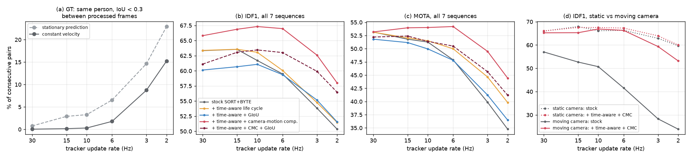

# Multi-Object Tracking on MOT17: SORT / ByteTrack-style association with YOLO11

[](https://github.com/HessamKaveh/object-tracking-sort/actions/workflows/ci.yml)   [](LICENSE)

Tracking-by-detection on the real **MOT17** pedestrian benchmark, plus a robotics question the leaderboards skip: **what happens when the tracker cannot run at camera rate?** ([jump to the study](#stress-test-how-slow-can-the-perception-loop-get)). The project includes:
- a from-scratch **SORT** tracker (Kalman filter + Hungarian matching on IoU, Bewley et al. 2016);
- an optional **BYTE** second association stage (Zhang et al., ECCV 2022), which also matches low-confidence detections;
- three detectors evaluated with the same tracker: MOT17's public Faster R-CNN detections, YOLO11s with COCO weights, and **YOLO11s fine-tuned on MOT17**;
- a **processing-rate stress test** (30 → 2 Hz) with a detector-free diagnostic, an oracle-detector control, and a fix (**time-aware life cycle + camera-motion compensation**) that keeps IDF1 at or above the 30 Hz baseline down to 6 Hz.

<p align="center"></p>

*MOT17-03 from the MOT17 **test** set (never used for training or tuning; first 7 s of the MOTChallenge preview video; [CC BY-NC-SA 3.0](https://motchallenge.net/data/MOT17/), so this GIF is shared under the same licence), tracked with the fine-tuned YOLO11s + SORT/BYTE via `src/track.py`. Box colour / number = track identity.*

## Results: MOT17 val-half (7 sequences)

| Detector | Tracker | **MOTA** ↑ | **IDF1** ↑ | IDSW ↓ | FP ↓ | FN ↓ | Recall | Precision | MT ↑ | ML ↓ |
|---|---|---|---|---|---|---|---|---|---|---|
| Public FRCNN | SORT | 46.5 | 57.0 | 184 | 341 | 28,405 | 47.4 | 98.7 | 62 | 124 |
| Public FRCNN | SORT + BYTE | 46.8 | 57.1 | 188 | 473 | 28,093 | 48.0 | 98.2 | 64 | 122 |
| YOLO11s (COCO) | SORT | 37.2 | 51.1 | 136 | 1,631 | 32,174 | 40.5 | 93.1 | 60 | 139 |
| YOLO11s (COCO) | SORT + BYTE | 42.4 | 56.2 | 144 | 2,692 | 28,271 | 47.7 | 90.5 | 76 | 121 |
| **YOLO11s (MOT17 fine-tuned)** | **SORT** | **53.3** | **64.6** | 285 | 4,489 | 20,454 | 62.2 | 88.2 | 92 | 93 |
| YOLO11s (MOT17 fine-tuned) | SORT + BYTE | 53.2 | 63.3 | 352 | 7,795 | **17,167** | **68.2** | 82.5 | **108** | **69** |

**Findings:**
- **The detector matters most.** With an identical tracker, fine-tuning YOLO11s on the MOT17 train halves raises MOTA from 37.2 to **53.3** (+16.1) and IDF1 from 51.1 to **64.6**. COCO "person" boxes miss many small, occluded and crowded pedestrians (recall 40.5 %). The fine-tuned detector reaches 62 % recall and also beats the public Faster R-CNN detections by 6.8 MOTA.
- **BYTE helps most when the detector is weak or miscalibrated.** Recovering low-score boxes in a second association round adds +5.2 MOTA / +5.1 IDF1 for the COCO detector. With the fine-tuned detector, BYTE raises recall (68 %) and mostly-tracked identities (108 vs 92) but adds about the same number of false positives, so MOTA stays flat. That precision/recall trade-off is tunable through the thresholds.
- **ID switches grow with recall.** More detected people in crowds means more chances to swap identities. SORT has no appearance model, so IDSW is its main weakness, and an appearance-based tracker (DeepSORT, BoT-SORT) would be the next step.

### Per-sequence (fine-tuned YOLO11s + SORT + BYTE)

| Sequence | Scene | MOTA | IDF1 | IDSW |
|---|---|---|---|---|
| MOT17-02 | crowded square, static camera | 32.0 | 41.7 | 120 |
| MOT17-04 | dense crowd at night, elevated view | 60.0 | 75.0 | 69 |
| MOT17-05 | street, moving camera (low) | 48.2 | 54.5 | 50 |
| MOT17-09 | shopping street, static | 65.7 | 68.3 | 20 |
| MOT17-10 | night street, moving camera | 54.5 | 60.5 | 33 |
| MOT17-11 | shopping mall, moving camera | 61.1 | 57.3 | 26 |
| MOT17-13 | bus-mounted camera, fast motion | 46.7 | 53.2 | 34 |

The hardest sequences are MOT17-02, with heavy occlusion and many small distant people, and MOT17-13, where fast camera motion breaks the constant-velocity Kalman model.

<p align="center"></p>

*MOT17-09 (val half), fine-tuned YOLO11s + SORT. Box colour / number = track identity.*

## Stress test: how slow can the perception loop get?

On a robot the person detector rarely runs at camera rate. It shares a GPU with other networks, runs on an embedded board, or the planner only asks for people a few times per second. Benchmarks report trackers at 25–30 Hz, so this study keeps the detections fixed and changes only **how often the tracker sees them**: every sequence is processed every *k*-th frame, with *k* = round(camera fps / target Hz), and scored on the processed frames only. Every phase offset 0…*k*−1 is run and pooled, so each rate still uses every val-half frame once.

<p align="center"></p>

**(a) The problem, measured without any detector.** For the same ground-truth person in two consecutive processed frames, the share of pairs with IoU < 0.3 (which an IoU-gated tracker cannot link even with a perfect detector) rises from 0.04 % at 30 Hz to 8.7 % at 3 Hz and 15 % at 2 Hz, even with a constant-velocity prediction.

**(b–d) What breaks, and what fixes it** (fine-tuned YOLO11s, MOT17 val-half, IDF1 / MOTA):

| Tracker | 30 Hz | 10 Hz | 6 Hz | 3 Hz | 2 Hz |
|---|---|---|---|---|---|
| Stock SORT + BYTE | 63.3 / 53.2 | 61.7 / 51.3 | 59.5 / 47.9 | 53.8 / 39.9 | 50.3 / 34.8 |
| + time-aware life cycle | 63.4 / 53.1 | 63.1 / 51.5 | 60.1 / 50.0 | 54.7 / 44.6 | 51.5 / 39.8 |
| + time-aware + GIoU association | 60.1 / 51.8 | 61.1 / 50.0 | 59.4 / 47.8 | 55.2 / 41.2 | 51.5 / 36.5 |
| **+ time-aware + camera-motion compensation** | **65.8 / 53.2** | **67.3 / 54.0** | **67.0 / 54.2** | **62.6 / 49.5** | **58.0 / 44.4** |
| Oracle detector (GT boxes), stock SORT + BYTE | 98.0 / 99.0 | 92.8 / 94.2 | 87.5 / 88.1 | 77.0 / 74.6 | 69.8 / 64.7 |
| Oracle detector, + time-aware + CMC | 98.9 / 99.4 | 99.0 / 99.6 | 97.2 / 99.2 | 88.1 / 93.2 | 79.2 / 84.8 |

**Findings:**
- **Stock SORT loses people before it loses identities.** Its life cycle is counted in *calls*: `min_hits = 3` means 0.1 s at 30 Hz but 1 s at 3 Hz, so recall drops from 68 % to 52 % at 3 Hz. Expressing confirmation (0.1 s) and deletion (1 s) in seconds gives the recall back (+4.7 MOTA at 3 Hz), but it exposes the identity problem that the missing tracks had been hiding.
- **The bottleneck is not the IoU gate.** The obvious fix, a similarity that still ranks boxes that no longer overlap (low-IoU threshold, GIoU, DIoU; thresholds chosen on the *train* half), moves IDF1 by only −3 to +2.5 points. With **perfect detections**, ID switches at 3 Hz still hit 15 % of boxes, about the share that a *stationary* predictor cannot link in (a). The motion model is the problem.
- **It is the camera that moves, not the people.** Split by camera (d): on the 3 static-camera sequences, stock SORT holds IDF1 ≈ 66 down to 6 Hz. On the 4 moving-camera sequences (handheld, vehicle-mounted) it falls from 57.0 at 30 Hz to 41.6 at 6 Hz and 28.3 at 3 Hz. Between two processed frames, ego-motion shifts every box together, and a per-person constant-velocity Kalman filter cannot represent that. A robot-mounted camera is exactly this case.
- **Camera-motion compensation fixes most of it, with no learning and no tuning.** A global similarity transform between processed frames (Lucas–Kanade on background corners, people masked out, RANSAC; `src/cmc.py`) is applied to every Kalman state before prediction. On moving-camera sequences, IDF1 at 6 Hz goes from 41.6 to **66.3**. Overall, the tracker at **6 Hz (67.0 IDF1) beats stock SORT at 30 Hz (63.3)**, and at 3 Hz it keeps 62.6. With an oracle detector, IDF1 stays ≥ 97 down to 6 Hz. In practice, a robot can run this detector 5× less often and still keep identities as well as stock SORT does at full rate.
- **Where it still fails:** below ~3 Hz, people in crowds turn and cross between updates. GIoU on top of CMC halves ID switches (oracle IDF1 at 3 Hz 88 → 90), but with a real detector its looser gate also links false positives (−2.7 IDF1), so it is off by default. An appearance model is the next step.

Same trends with the public FRCNN detections (stock 44.9 → CMC 54.7 IDF1 at 3 Hz); all numbers are in `results/framerate/sweep_val_half.json`, the train-half threshold search is in `results/framerate/tuned_thresholds.json`, and the GT diagnostic is in `results/framerate/gt_ceiling.json`.

```bash
python src/cmc.py                                        # camera-motion transforms for every stride (cached)
python src/framerate_study.py ceiling                    # (a) detector-free diagnostic
python src/framerate_study.py tune                       # thresholds on the train half (public FRCNN)
python src/framerate_study.py sweep --dets yolo11s_mot17 public_frcnn oracle_gt
python src/framerate_study.py plot
python src/track.py --source robot_cam.mp4 --weights runs/mot17_yolo11s/weights/best.pt --stride 10 --cmc
```

## Protocol

- **Split:** the standard *half-train / half-val* protocol used in the ByteTrack and FairMOT ablations. Each of the 7 MOT17 training sequences is cut in time: the first half of the frames is used to fine-tune the detector and the second half is used only for evaluation. The images are the same across the DPM/FRCNN/SDP copies, so the FRCNN copy is used.
- **Metrics:** CLEAR-MOT (MOTA, IDSW, FP, FN) and IDF1, computed with `motmetrics` and IoU threshold 0.5. Predictions matched to *distractor* ground truth (person on vehicle, static person, distractor, reflection; classes 2, 7, 8, 12) are removed before scoring, as in the official MOTChallenge / TrackEval preprocessing. Only pedestrians (class 1) with the `consider` flag set count as targets, with no visibility threshold.
- **Detector fine-tune:** YOLO11s (COCO init), MOT17 train halves (classes 1/2/7 → `person`), the last 10 % of each half for validation, 12 epochs at 1088 px, batch 2. Detection mAP50-95 rose from 0.51 to 0.62 on the held-out frames.

## Tracker

| | |
|---|---|
| State | Kalman filter on [u, v, s, r, u̇, v̇, ṡ], constant velocity; the original SORT noise settings |
| Association | Hungarian matching on IoU (≥ 0.3) between Kalman predictions and detections with score ≥ 0.5 (GIoU / DIoU optional) |
| Camera motion | optional: 2×3 similarity transform per update applied to state and covariance (`Tracker.update(..., warp=A)`) |
| BYTE stage | still-unmatched tracks are matched to the low-score detections (0.1–0.5); a new track starts only from a detection with score ≥ 0.6 |
| Life cycle | track confirmed after 3 hits, deleted after 30 missed frames |

## Dataset

[MOT17](https://motchallenge.net/data/MOT17/), training set (7 sequences, 5,316 frames, ground truth and public DPM/FRCNN/SDP detections).

```bash
wget https://motchallenge.net/data/MOT17.zip && unzip MOT17.zip
export MOT17_ROOT=$PWD/MOT17
```

## Usage

```bash
pip install -r requirements.txt
cd weights && python ../src/finetune_detector.py --epochs 12 --batch 2 --imgsz 1088 && cd ..
python src/detect.py --weights weights/yolo11s.pt --name yolo11s_coco                       # cache detections
python src/detect.py --weights runs/mot17_yolo11s/weights/best.pt --name yolo11s_mot17
python src/run_benchmark.py         # every detector x tracker -> results/mot17_val_half.json
python src/track.py --mot_seq MOT17-09 --weights runs/mot17_yolo11s/weights/best.pt \
                    --out demo.mp4 --gif results/demo_MOT17-09.gif --max_frames 150
```

## Repository layout

```
src/sort.py               Kalman box track, IoU matching, SORT / BYTE tracker
src/mot.py                MOT17 sequences, half split, GT / public-detection loaders, MOT writer
src/detect.py             YOLO inference over the val halves (cached)
src/finetune_detector.py  YOLO11s fine-tuning on the MOT17 train halves
src/evaluate.py           motmetrics accumulation with distractor removal
src/run_benchmark.py      full detector x tracker table
src/track.py              visual demo (MP4 / GIF); --stride / --cmc for a slow loop on a moving camera
src/cmc.py                camera-motion compensation (sparse optical flow + RANSAC similarity)
src/framerate_study.py    processing-rate stress test: GT diagnostic, train-half tuning, sweep, figure
results/                  metrics tables, per-sequence results, MOT-format track files, demo GIF
results/framerate/        stress-test tables and figure
```

## Author
Hessam Kaveh — Research Fellow, Italian Institute of Technology (IIT)

## License

Released under the [MIT License](LICENSE).
