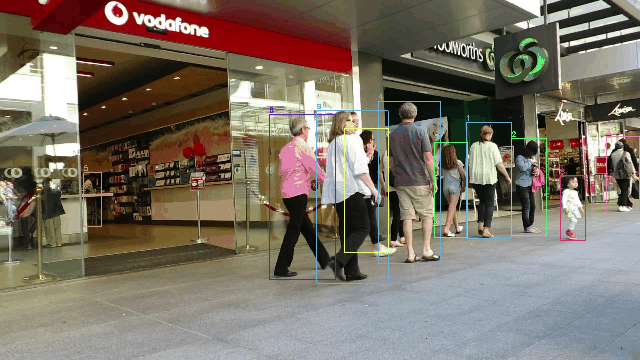

# Multi-Object Tracking on MOT17: SORT / ByteTrack-style association with YOLO11

[](https://github.com/HessamKaveh/object-tracking-sort/actions/workflows/ci.yml)   [](LICENSE)

Tracking-by-detection on the real **MOT17** pedestrian benchmark. The project includes:
- a from-scratch **SORT** tracker (Kalman filter + Hungarian matching on IoU, Bewley et al. 2016);
- an optional **BYTE** second association stage (Zhang et al., ECCV 2022), which also matches low-confidence detections;
- three detectors evaluated with the same tracker: MOT17's public Faster R-CNN detections, YOLO11s with COCO weights, and **YOLO11s fine-tuned on MOT17**.

<p align="center"></p>

*MOT17-03 from the MOT17 **test** set (never used for training or tuning; first 7 s of the MOTChallenge preview video; [CC BY-NC-SA 3.0](https://motchallenge.net/data/MOT17/), so this GIF is shared under the same licence), tracked with the fine-tuned YOLO11s + SORT/BYTE via `src/track.py`. Box colour / number = track identity.*

## Results: MOT17 val-half (7 sequences)

| Detector | Tracker | **MOTA** ↑ | **IDF1** ↑ | IDSW ↓ | FP ↓ | FN ↓ | Recall | Precision | MT ↑ | ML ↓ |
|---|---|---|---|---|---|---|---|---|---|---|
| Public FRCNN | SORT | 46.5 | 57.0 | 184 | 341 | 28,405 | 47.4 | 98.7 | 62 | 124 |
| Public FRCNN | SORT + BYTE | 46.8 | 57.1 | 188 | 473 | 28,093 | 48.0 | 98.2 | 64 | 122 |
| YOLO11s (COCO) | SORT | 37.2 | 51.1 | 136 | 1,631 | 32,174 | 40.5 | 93.1 | 60 | 139 |
| YOLO11s (COCO) | SORT + BYTE | 42.4 | 56.2 | 144 | 2,692 | 28,271 | 47.7 | 90.5 | 76 | 121 |
| **YOLO11s (MOT17 fine-tuned)** | **SORT** | **53.3** | **64.6** | 285 | 4,489 | 20,454 | 62.2 | 88.2 | 92 | 93 |
| YOLO11s (MOT17 fine-tuned) | SORT + BYTE | 53.2 | 63.3 | 352 | 7,795 | **17,167** | **68.2** | 82.5 | **108** | **69** |

**Findings:**
- **The detector matters most.** With an identical tracker, fine-tuning YOLO11s on the MOT17 train halves raises MOTA from 37.2 to **53.3** (+16.1) and IDF1 from 51.1 to **64.6**. COCO "person" boxes miss many small, occluded and crowded pedestrians (recall 40.5 %). The fine-tuned detector reaches 62 % recall and also beats the public Faster R-CNN detections by 6.8 MOTA.
- **BYTE helps most when the detector is weak or miscalibrated.** Recovering low-score boxes in a second association round adds +5.2 MOTA / +5.1 IDF1 for the COCO detector. With the fine-tuned detector, BYTE raises recall (68 %) and mostly-tracked identities (108 vs 92) but adds about the same number of false positives, so MOTA stays flat. That precision/recall trade-off is tunable through the thresholds.
- **ID switches grow with recall.** More detected people in crowds means more chances to swap identities. SORT has no appearance model, so IDSW is its main weakness, and an appearance-based tracker (DeepSORT, BoT-SORT) would be the next step.

### Per-sequence (fine-tuned YOLO11s + SORT + BYTE)

| Sequence | Scene | MOTA | IDF1 | IDSW |
|---|---|---|---|---|
| MOT17-02 | crowded square, static camera | 32.0 | 41.7 | 120 |
| MOT17-04 | dense crowd at night, elevated view | 60.0 | 75.0 | 69 |
| MOT17-05 | street, moving camera (low) | 48.2 | 54.5 | 50 |
| MOT17-09 | shopping street, static | 65.7 | 68.3 | 20 |
| MOT17-10 | night street, moving camera | 54.5 | 60.5 | 33 |
| MOT17-11 | shopping mall, moving camera | 61.1 | 57.3 | 26 |
| MOT17-13 | bus-mounted camera, fast motion | 46.7 | 53.2 | 34 |

The hardest sequences are MOT17-02, with heavy occlusion and many small distant people, and MOT17-13, where fast camera motion breaks the constant-velocity Kalman model.

<p align="center"></p>

*MOT17-09 (val half), fine-tuned YOLO11s + SORT. Box colour / number = track identity.*

## Protocol

- **Split:** the standard *half-train / half-val* protocol used in the ByteTrack and FairMOT ablations. Each of the 7 MOT17 training sequences is cut in time: the first half of the frames is used to fine-tune the detector and the second half is used only for evaluation. The images are the same across the DPM/FRCNN/SDP copies, so the FRCNN copy is used.
- **Metrics:** CLEAR-MOT (MOTA, IDSW, FP, FN) and IDF1, computed with `motmetrics` and IoU threshold 0.5. Predictions matched to *distractor* ground truth (person on vehicle, static person, distractor, reflection; classes 2, 7, 8, 12) are removed before scoring, as in the official MOTChallenge / TrackEval preprocessing. Only pedestrians (class 1) with the `consider` flag set count as targets, with no visibility threshold.
- **Detector fine-tune:** YOLO11s (COCO init), MOT17 train halves (classes 1/2/7 → `person`), the last 10 % of each half for validation, 12 epochs at 1088 px, batch 2. Detection mAP50-95 rose from 0.51 to 0.62 on the held-out frames.

## Tracker

| | |
|---|---|
| State | Kalman filter on [u, v, s, r, u̇, v̇, ṡ], constant velocity; the original SORT noise settings |
| Association | Hungarian matching on IoU (≥ 0.3) between Kalman predictions and detections with score ≥ 0.5 |
| BYTE stage | still-unmatched tracks are matched to the low-score detections (0.1–0.5); a new track starts only from a detection with score ≥ 0.6 |
| Life cycle | track confirmed after 3 hits, deleted after 30 missed frames |

## Dataset

[MOT17](https://motchallenge.net/data/MOT17/), training set (7 sequences, 5,316 frames, ground truth and public DPM/FRCNN/SDP detections).

```bash
wget https://motchallenge.net/data/MOT17.zip && unzip MOT17.zip
export MOT17_ROOT=$PWD/MOT17
```

## Usage

```bash
pip install -r requirements.txt
cd weights && python ../src/finetune_detector.py --epochs 12 --batch 2 --imgsz 1088 && cd ..
python src/detect.py --weights weights/yolo11s.pt --name yolo11s_coco                       # cache detections
python src/detect.py --weights runs/mot17_yolo11s/weights/best.pt --name yolo11s_mot17
python src/run_benchmark.py         # every detector x tracker -> results/mot17_val_half.json
python src/track.py --mot_seq MOT17-09 --weights runs/mot17_yolo11s/weights/best.pt \
                    --out demo.mp4 --gif results/demo_MOT17-09.gif --max_frames 150
```

## Repository layout

```
src/sort.py               Kalman box track, IoU matching, SORT / BYTE tracker
src/mot.py                MOT17 sequences, half split, GT / public-detection loaders, MOT writer
src/detect.py             YOLO inference over the val halves (cached)
src/finetune_detector.py  YOLO11s fine-tuning on the MOT17 train halves
src/evaluate.py           motmetrics accumulation with distractor removal
src/run_benchmark.py      full detector x tracker table
src/track.py              visual demo (MP4 / GIF)
results/                  metrics tables, per-sequence results, MOT-format track files, demo GIF
```

## Author
Hessam Kaveh — Research Fellow, Italian Institute of Technology (IIT)

## License

Released under the [MIT License](LICENSE).
